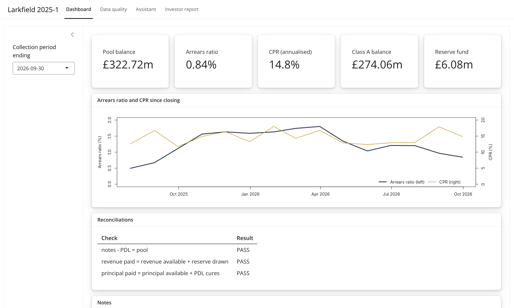
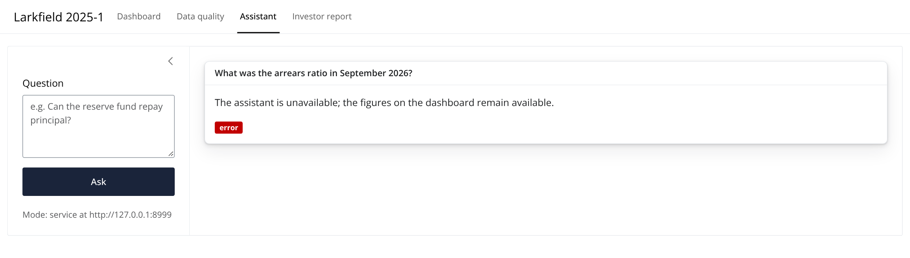

# 23. The Structured Finance Application in R Shiny

## Exercises

**Exercise 23.1.** Add a fifth tile, *Reserve fund*, to the dashboard. Which field of `month_figures()` do you use, and what does the tile show for 30 September 2026?

**Exercise 23.2.** Select the collection period ending 31 March 2026. Write down the four tiles and explain the arrears ratio by reference to Chapter 14.

**Exercise 23.3.** Start the application in mode 2 with no service running. What does the user see when asking a question, and what do the other tabs do? Write the test.

**Exercise 23.4.** Add a review queue: every answer with status `needs_review` is appended to `logs/review_queue.csv` with the time, the question, the answer and the unsupported figures.

**Exercise 23.5.** A colleague proposes to fill the dashboard tiles by asking the agent *“What is the pool balance?”* and displaying its answer. Give three reasons against.

## Corrections

### Exercise 23.1

**What the question asks.** Add a fifth tile, *Reserve fund*, to the dashboard, say which field of `month_figures()` it uses, and give its value for 30 September 2026.

**The plan.** (1) Find the field. (2) Add an output placeholder in the UI. (3) Fill it in the server from the existing reactive expression. (4) Test it with `testServer()`.

**Step by step.**

*Step 1 — The field.* `names(month_figures("2026-09-30"))` lists `reserve`: the reserve fund balance after the month’s waterfall, in pounds.

*Step 2 — The UI.* In the Dashboard’s `layout_columns(...)`, add a fifth box:

`apps/solutions/ex23_1/app.R` (extract)

``` r
value_box("Reserve fund", textOutput("kpi_reserve"))
```

- `value_box()` (from `bslib`) draws a tile with a title and a value; `textOutput("kpi_reserve")` reserves the place the server will fill.

*Step 3 — The server.*

`apps/solutions/ex23_1/app.R` (extract)

``` r
output$kpi_reserve <- renderText(gbp(figures()$reserve / 1e6, 2) |> paste0("m"))
```

- `figures()` is the reactive expression already used by the other tiles, so no new computation runs when the date changes.
- `gbp(x, 2)` formats pounds with two decimals and thousands separators; dividing by one million and adding *m* matches the other tiles.

**Reading the result.** The tile shows **£6.08m**: the Reserve Fund Required Amount of £6,082,667.80 (1.50% of the pool at the initial cut-off date, 30 June 2025, Chapter 3), which does not amortise and has never been drawn.

**Checking the answer.** Add to `tests/test_sf_app.R`, inside `testServer()`:

`tests/solutions/test_ex23_1.R` (extract)

``` r
stopifnot(output$kpi_reserve == "£6.08m")
```

and run the test. Change the date to 2026-03-31: the tile still shows £6.08m, as it must for a reserve that was never drawn.

**Mistakes to avoid.**

- Calling `month_figures()` again inside the new `renderText()`: it works, but it doubles the work at every date change.
- Running the test in a session whose locale is not UTF-8: the pound sign then prints as `<U+00A3>` and the comparison fails. Run with `LANG=C.UTF-8`, or compare without the sign.

**Trade-offs.** Five tiles of equal width are narrower: on a laptop screen the amounts wrap onto two lines. Shorten the labels or drop the decimals. A tile is read in a second: choose fewer, clearer tiles over more. A reserve that never moves may be better as a line in the reconciliation table than as a tile.

**On GitHub.** The companion repository goes further: the complete application with the fifth tile (`apps/solutions/ex23_1/app.R`), every changed line in context, a test over three dates with its output, and a screenshot, in `solutions/ch23_corrections.md`.

#### Going further on GitHub: building the tile in the application

This part is in the companion repository only. It shows the complete application with the change, every line that changes, the full test with its output, and the screen you should see.

**The complete application.** `apps/solutions/ex23_1/app.R` is the application of Chapter 23 with the fifth tile. Start it from the repository root:

``` bash
Rscript -e 'shiny::runApp("apps/solutions/ex23_1", port = 8111)'
```

and open `http://localhost:8111`. The file is a copy of `apps/sf_app/app.R`, so you can compare the two and see the whole exercise as a difference between files.

**Every change, in context.** The lines starting with `-` are in the application of Chapter 23; the lines starting with `+` replace them in the solution.

``` diff
--- apps/sf_app/app.R
+++ apps/solutions/ex23_1/app.R
@@ -1,3 +1,3 @@
-# Larkfield 2025-1 — the structured finance application (Chapter 23)
-# Run from the repository root:  Rscript -e 'shiny::runApp("apps/sf_app", port = 8101)'
+# Exercise 23.1 - the SF application with a fifth tile, Reserve fund
+# Run from the repository root:  Rscript -e 'shiny::runApp("apps/solutions/ex23_1", port = 8111)'
 # The packages this application uses, with the oldest version the book was tested with: a package that is
@@ -19,3 +19,3 @@
 library(shiny); library(bslib); library(DT)
-root <- normalizePath(Sys.getenv("AIE_ROOT", "../.."))   # runApp starts in apps/sf_app; work from the repository root
+root <- normalizePath(Sys.getenv("AIE_ROOT", "../../.."))   # runApp starts in apps/solutions/ex23_1; work from the repository root
 setwd(root)
@@ -57,3 +57,4 @@
         value_box("Pool balance", textOutput("kpi_pool")), value_box("Arrears ratio", textOutput("kpi_arrears")),
-        value_box("CPR (annualised)", textOutput("kpi_cpr")), value_box("Class A balance", textOutput("kpi_classa"))),
+        value_box("CPR (annualised)", textOutput("kpi_cpr")), value_box("Class A balance", textOutput("kpi_classa")),
+        value_box("Reserve fund", textOutput("kpi_reserve"))),
       card(card_header("Arrears ratio and CPR since closing"), plotOutput("trend", height = 260)),
@@ -87,2 +88,3 @@
   output$kpi_classa  <- renderText(gbp(figures()$notes["A", "closing"] / 1e6, 2) |> paste0("m"))
+  output$kpi_reserve <- renderText(gbp(figures()$reserve / 1e6, 2) |> paste0("m"))
   series <- reactive({
```

- Lines 1 and 2 are the file’s title and the command that runs it.
- `"../../.."` replaces `"../.."`: the solution is one folder deeper (`apps/solutions/ex23_1`), and `runApp()` starts in that folder, so three levels up is the repository root. Forget this and `source("aie_r/assistants.R")` fails with *cannot open file*.
- The closing bracket of `layout_columns(...)` moves from the fourth `value_box()` to the fifth: the new box must be inside the call, or it appears below the grid at full width.
- The new `renderText()` sits beside the other four, reads the same `figures()` and formats the same way.

**Develop it in four moves.** (1) Run `names(month_figures("2026-09-30"))` in the R console from the repository root and find `reserve`. (2) Add the `value_box()` and start the application: an empty tile proves the UI part works. (3) Add the `renderText()` and reload the browser page: the value appears. (4) Write the test, so that a later change cannot break the tile without you knowing.

**The test, in full.** It checks three dates, not one: a reserve that never moves must show the same value for the first collection period, the arrears peak and the last period.

`tests/solutions/test_ex23_1.R`

``` r
# Exercise 23.1 - the Reserve fund tile
# Run from the repository root:  LANG=C.UTF-8 Rscript tests/solutions/test_ex23_1.R
library(shiny)
Sys.setenv(AIE_ROOT = getwd())
app <- suppressPackageStartupMessages(source("apps/solutions/ex23_1/app.R")$value)
testServer(app, {
  for (d in c("2026-09-30", "2026-03-31", "2025-07-31")) {
    session$setInputs(date = d)
    cat(d, "| reserve fund tile:", output$kpi_reserve, "| raw value:", format(figures()$reserve, nsmall = 2), "\n")
    stopifnot(output$kpi_reserve == "£6.08m")          # never drawn: the same at every date
  }
})
cat("Exercise 23.1 test passed\n")
```

**Output**

``` text
2026-09-30 | reserve fund tile: £6.08m | raw value: 6082667.80 
2026-03-31 | reserve fund tile: £6.08m | raw value: 6082667.80 
2025-07-31 | reserve fund tile: £6.08m | raw value: 6082667.80 
Exercise 23.1 test passed
```

- `figures()` is a reactive expression of the server; inside `testServer()` you can call it directly, as the server does.
- `format(figures()$reserve, nsmall = 2)` prints the raw value: £6,082,667.80 rounds to the £6.08m of the tile.

**What you should see.**

<figure>

<figcaption aria-hidden="true">The dashboard with five tiles: the Reserve fund tile shows £6.08m</figcaption>
</figure>

The screen confirms the trade-off of the correction: with five tiles at a width of 1,280 pixels, *£322.72m* and *£274.06m* wrap onto two lines, while *£6.08m* fits.

**More mistakes to avoid.**

- A typo between the UI and the server (`textOutput("kpi_reserve")` but `output$kpi_resrve`): the tile stays empty and no error appears, because Shiny does not check that every output has a renderer. The test catches it.
- Editing `apps/sf_app/app.R` and the solution at the same time. Keep the application of the chapter unchanged, so that the tests of Chapter 23 still describe it.

**More trade-offs.** To stop the wrap, write the large amounts without decimals (`gbp(x / 1e6, 1)` gives *£322.7m*) or give the tiles a fixed minimum width with `layout_columns(col_widths = ...)` so that the fifth one moves to a second row. The first keeps one row and loses precision; the second keeps precision and pushes the chart down the page.

### Exercise 23.2

**What the question asks.** Select 31 March 2026, write down the four tiles, and explain the arrears ratio with Chapter 14.

**The plan.** (1) Select the date. (2) Read the tiles. (3) Explain the ratio from the tape. (4) Cross-check with the Investor report tab.

**Step by step.** Select 2026-03-31 in the sidebar. The tiles are computed by `month_figures("2026-03-31")`; the trend chart is unchanged, since it shows every date.

**Reading the result.** Pool balance **£352.87m**, arrears ratio **1.80%**, CPR **16.8%**, Class A balance **£304.20m**. The three reconciliation checks pass.

The trend chart shows the arrears ratio rising from 0.50% for the first collection period (ending 31 July 2025) to its peak of 1.80% on 31 March 2026, then falling. Exercise 14.3 traced what became of the 34 loans in arrears in March: 16 returned to performing, 7 were restructured with no arrears, 8 defaulted, 2 redeemed and 1 remained in arrears. Cures and defaults both remove loans from the arrears buckets, which is why the ratio fell to 0.84% by September, less than half its peak.

**Checking the answer.** Open the Investor report tab for March: the template commentary reads *“The arrears ratio rose to 1.80% from 1.74%”*. The same figures, from the same function, in words. In `testServer()`, `session$setInputs(date = "2026-03-31")` gives `output$kpi_arrears == "1.80%"`.

**Mistakes to avoid.**

- Comparing tiles across dates by memory: March’s CPR of 16.8% is higher than September’s 14.8%. Read each tile against its own history on the trend chart.
- Concluding from the tile alone that the deal improved after March. A falling arrears ratio is good news only when cures, not defaults, explain it.

**Trade-offs.** The dashboard shows *what* the figures are; the explanation (cures versus defaults) needed the loan-level analysis of Chapter 14. Adding a *cumulative defaults* tile would put both sides on screen, at the cost of a sixth tile; a better place may be a line under the trend chart.

### Exercise 23.3

**What the question asks.** Start the application in mode 2 with no service running: what does the user see when asking a question, and what do the other tabs do? Write the test.

**The plan.** (1) Point the application at an address where nothing listens. (2) Ask a question and follow `ask_agent()`. (3) Check the other tabs. (4) Write a `testServer()` test of both.

**Step by step.**

``` bash
AIE_SERVICE_URL=http://127.0.0.1:9 Rscript -e 'shiny::runApp("apps/sf_app", port = 8101)'
```

When the user asks, `ask_agent()` builds the request and `httr2::req_perform()` fails with *connection refused*; `tryCatch` returns `NULL`; the function returns the fall-back result:

`apps/solutions/ex23_3/app.R` (extract)

``` r
  if (is.null(resp) || httr2::resp_status(resp) != 200)
    return(list(answer = "The assistant is unavailable; the figures on the dashboard remain available.",
                status = "error", trace = list(), unsupported = character(0)))
```

**Reading the result.** The Assistant tab shows that sentence with a red *error* badge. The Dashboard, Data quality and Investor report tabs work normally: they never call the service.

**Checking the answer.**

`chapters/ch23/r/solutions/ex23_3_minimum.R`

``` r
library(shiny)
Sys.setenv(AIE_ROOT = getwd(), AIE_SERVICE_URL = "http://127.0.0.1:9")
app <- source("apps/sf_app/app.R")$value
testServer(app, {
  session$setInputs(date = "2026-03-31")
  stopifnot(output$kpi_arrears == "1.80%")                       # dashboard works
  session$setInputs(question = "What was the arrears ratio in September 2026?", ask = 1)
  stopifnot(log()[[1]]$r$status == "error")                      # assistant fails gracefully
})
```

- `Sys.setenv()` must come **before** `source()`: the file reads `AIE_SERVICE_URL` when it is loaded.
- `session$setInputs(ask = 1)` simulates a click on *Ask*.

Both conditions hold.

**Mistakes to avoid.**

- Testing with the variable set after sourcing the app: the app stays in mode 1 and the test passes for the wrong reason.
- Showing the HTTP error to the user. *Connection refused* means nothing to an analyst.

**Trade-offs.** The error sentence does not say *why* the assistant is unavailable. For the analyst, that is right: they cannot fix the service. For the support team, the reason must be logged; add `message(conditionMessage(e))` in the `error` handler of `tryCatch` so that it appears in the application’s log.

**On GitHub.** The companion repository goes further: an application that logs the reason of the failure for the support team (`apps/solutions/ex23_3/app.R`), every changed line in context, the full test with its output, and a screenshot, in `solutions/ch23_corrections.md`.

#### Going further on GitHub: the application that tells the support team why

This part is in the companion repository only. The book’s trade-off recommends logging the reason for the failure; the solution application does it, and the test proves the analyst still sees the plain sentence.

**The complete application.** `apps/solutions/ex23_3/app.R`. Start it in mode 2 with nothing listening on port 9:

``` bash
AIE_SERVICE_URL=http://127.0.0.1:9 Rscript -e 'shiny::runApp("apps/solutions/ex23_3", port = 8113)'
```

**Every change, in context.**

``` diff
--- apps/sf_app/app.R
+++ apps/solutions/ex23_3/app.R
@@ -1,3 +1,3 @@
-# Larkfield 2025-1 — the structured finance application (Chapter 23)
-# Run from the repository root:  Rscript -e 'shiny::runApp("apps/sf_app", port = 8101)'
+# Exercise 23.3 - the SF application, which logs why the service is unavailable
+# Run from the repository root:  AIE_SERVICE_URL=http://127.0.0.1:9 Rscript -e 'shiny::runApp("apps/solutions/ex23_3", port = 8113)'
 # The packages this application uses, with the oldest version the book was tested with: a package that is
@@ -19,3 +19,3 @@
 library(shiny); library(bslib); library(DT)
-root <- normalizePath(Sys.getenv("AIE_ROOT", "../.."))   # runApp starts in apps/sf_app; work from the repository root
+root <- normalizePath(Sys.getenv("AIE_ROOT", "../../.."))   # runApp starts in apps/solutions/ex23_3; work from the repository root
 setwd(root)
@@ -36,3 +36,4 @@
                      httr2::req_timeout(300) |> httr2::req_error(is_error = function(r) FALSE) |>
-                     httr2::req_perform(), error = function(e) NULL)
+                     httr2::req_perform(),
+                   error = function(e) { message("Assistant service unavailable: ", conditionMessage(e)); NULL })
   if (is.null(resp) || httr2::resp_status(resp) != 200)
```

- `"../../.."`: the solution is one folder deeper than `apps/sf_app` (see Exercise 23.1).
- The error handler of `tryCatch()` now has a body in braces: `message(...)` writes the reason to the application’s log (the terminal where you ran `runApp()`, or the server’s log file), then `NULL` is returned as before, so `ask_agent()` still gives the user the fall-back sentence.
- `conditionMessage(e)` is the text of the error, here *Failed to connect to 127.0.0.1 port 9*: what the support team needs and the analyst does not.

**The test, in full.** It checks that two tabs keep working, that the assistant fails with status `error`, and that the trace is empty (no tool ran).

`tests/solutions/test_ex23_3.R`

``` r
# Exercise 23.3 - the application in mode 2 with no service running
# Run from the repository root:  LANG=C.UTF-8 Rscript tests/solutions/test_ex23_3.R
library(shiny)
Sys.setenv(AIE_ROOT = getwd(), AIE_SERVICE_URL = "http://127.0.0.1:9")   # before source(): the file reads it when loaded
app <- suppressPackageStartupMessages(source("apps/solutions/ex23_3/app.R")$value)
testServer(app, {
  session$setInputs(date = "2026-03-31", rdate = "2026-03-31")
  stopifnot(output$kpi_arrears == "1.80%")                               # Dashboard works
  stopifnot(nchar(output$commentary) > 0)                                # Investor report works
  session$setInputs(question = "What was the arrears ratio in September 2026?", ask = 1)
  r <- log()[[1]]$r
  cat("Assistant status:", r$status, "\n", "Answer shown:", r$answer, "\n")
  stopifnot(r$status == "error", length(r$trace) == 0)                   # fails gracefully
})
Sys.unsetenv("AIE_SERVICE_URL")
cat("Exercise 23.3 test passed\n")
```

**Output**

``` text
Assistant service unavailable: Failed to perform HTTP request.
Caused by error in `curl::curl_fetch_memory()`:
! Failed to connect to 127.0.0.1 port 9 after 0 ms: Couldn't connect to server
Assistant status: error 
 Answer shown: The assistant is unavailable; the figures on the dashboard remain available. 
Exercise 23.3 test passed
```

The first three lines of the output are the `message()` of the application, what the support team reads; the next two lines are what the analyst sees.

- `Sys.unsetenv("AIE_SERVICE_URL")` at the end restores the session, so a test run after this one in the same R session is not in mode 2 by accident.

**What you should see.**

<figure>

<figcaption aria-hidden="true">The Assistant tab with the sentence “The assistant is unavailable” and a red error badge</figcaption>
</figure>

The sidebar shows *Mode: service at http://127.0.0.1:9*: the mode line recommended in the chapter’s tips tells anyone looking at the screen which configuration failed.

**More mistakes to avoid.**

- Logging the whole request to find the cause: the request carries the `x-api-key` header, and the key then sits in the log. Log `conditionMessage(e)` only.
- Testing mode 2 against a port where another program listens. Port 9 (*discard*) has nothing listening on a normal machine, so the connection is refused at once instead of waiting for the 300-second timeout.

**More trade-offs.** `message()` writes one line per failed question; with fifty analysts and a service down for an hour, the log fills with identical lines. A production application records the first failure and then one line a minute, or reports to the monitoring of Chapter 19, which already counts errors by hour.

### Exercise 23.4

**What the question asks.** Add a review queue: every answer with status `needs_review` is appended to `logs/review_queue.csv` with the time, the question, the answer and the unsupported figures.

**The plan.** (1) Find where the answer’s status is known: the `observeEvent(input$ask, ...)` observer. (2) Append one row per such answer. (3) Test it with a scripted model that produces an unsupported figure.

**Step by step.** In the observer, after `r` is known:

`apps/solutions/ex23_4/app.R` (extract)

``` r
if (identical(r$status, "needs_review")) {
  dir.create("logs", showWarnings = FALSE)
  row <- data.frame(time = format(Sys.time(), "%Y-%m-%dT%H:%M:%S"), question = input$question,
                    answer = r$answer, unsupported = paste(r$unsupported, collapse = "; "))
  f <- "logs/review_queue.csv"
  write.table(row, f, sep = ",", row.names = FALSE, col.names = !file.exists(f), append = file.exists(f))
}
```

- `identical()` is safe even if `status` is missing.
- `col.names = !file.exists(f)` writes the header only the first time; `append = file.exists(f)` adds to an existing file.
- `write.table()` quotes text fields, so answers containing commas stay in one column.

**Reading the result.** The script `tools/scripts/ch23_review.json` replays a model that calls `arrears_buckets` and then writes £1,098,476.03 instead of £1,088,476.03, twice: the answer and the one correction of Chapter 9. With the mock replaying that script (the repository’s test starts it on a free port) and the question *What was the balance of the loans two months in arrears at 30 September 2026?* in `testServer()`:

**What you should see**

``` text
needs_review | £1,098,476.03
[1] 1
[1] "£1,098,476.03"
```

One row, with the unsupported figure.

**Checking the answer.** Read the queue: `nrow(read.csv("logs/review_queue.csv")) == 1`. Then ask a guarded question (*“Should I buy the Class B notes?”*): status `declined`, no new row. Only `needs_review` answers enter the queue.

**Mistakes to avoid.**

- Writing the queue inside the repository’s tracked files. `logs/` is in `.gitignore`: review data does not belong in Git.
- Queueing `error` answers too: they contain no draft to review.

**Trade-offs.** A CSV file is enough for one analyst. With several users on one server, two sessions can append at the same moment and corrupt a line; use the service’s JSONL log (one line per write) or a database table instead. A typo of one digit, caught by verification and routed to a person, is exactly what the queue is for.

**On GitHub.** The companion repository goes further: the complete application with the queue (`apps/solutions/ex23_4/app.R`), every changed line in context, and an end-to-end test with the scripted model and its output, in `solutions/ch23_corrections.md`.

#### Going further on GitHub: the review queue, tested end to end

This part is in the companion repository only: the complete application, the change in context, and a test that runs the whole path, from a scripted model writing a wrong figure to the row in the queue.

**The complete application.** `apps/solutions/ex23_4/app.R`:

``` bash
Rscript -e 'shiny::runApp("apps/solutions/ex23_4", port = 8114)'
```

**Every change, in context.**

``` diff
--- apps/sf_app/app.R
+++ apps/solutions/ex23_4/app.R
@@ -1,3 +1,3 @@
-# Larkfield 2025-1 — the structured finance application (Chapter 23)
-# Run from the repository root:  Rscript -e 'shiny::runApp("apps/sf_app", port = 8101)'
+# Exercise 23.4 - the SF application with a review queue for answers that need review
+# Run from the repository root:  Rscript -e 'shiny::runApp("apps/solutions/ex23_4", port = 8114)'
 # The packages this application uses, with the oldest version the book was tested with: a package that is
@@ -19,3 +19,3 @@
 library(shiny); library(bslib); library(DT)
-root <- normalizePath(Sys.getenv("AIE_ROOT", "../.."))   # runApp starts in apps/sf_app; work from the repository root
+root <- normalizePath(Sys.getenv("AIE_ROOT", "../../.."))   # runApp starts in apps/solutions/ex23_4; work from the repository root
 setwd(root)
@@ -131,2 +131,9 @@
     log(c(list(list(q = input$question, r = r)), log()))
+    if (identical(r$status, "needs_review")) {
+      dir.create("logs", showWarnings = FALSE)
+      row <- data.frame(time = format(Sys.time(), "%Y-%m-%dT%H:%M:%S"), question = input$question,
+                        answer = r$answer, unsupported = paste(r$unsupported, collapse = "; "))
+      f <- "logs/review_queue.csv"
+      write.table(row, f, sep = ",", row.names = FALSE, col.names = !file.exists(f), append = file.exists(f))
+    }
     updateTextAreaInput(session, "question", value = "")
```

- The new block sits after `log(...)` and before `updateTextAreaInput(...)`: at that point `r` is known and `input$question` still holds the question. Placed after `updateTextAreaInput()`, the code still reads the question, because the input changes only when the observer has finished; placing it before makes that explicit.
- `dir.create("logs", showWarnings = FALSE)` creates the folder on a fresh clone, where `logs/` does not exist because it is in `.gitignore`.

**The test, in full.** The test starts the mock model on the script of this exercise itself, on a free port; run it from the repository root:

``` bash
LANG=C.UTF-8 Rscript tests/solutions/test_ex23_4.R
```

`tests/solutions/test_ex23_4.R`

``` r
# Exercise 23.4 - the review queue
# The mock model replays a scripted answer with a wrong figure; the test starts it on a free port.
# From the repository root:  LANG=C.UTF-8 Rscript tests/solutions/test_ex23_4.R
library(shiny)
Sys.setenv(AIE_ROOT = getwd())
unlink("logs/review_queue.csv")                                          # start from an empty queue
app <- suppressPackageStartupMessages(source("apps/solutions/ex23_4/app.R")$value)
source("tools/mock.R")
mock <- start_mock("tools/scripts/ch23_review.json")                    # after the app has set its model address
testServer(app, {
  session$setInputs(question = "What was the balance of the loans two months in arrears at 30 September 2026?", ask = 1)
  r <- log()[[1]]$r
  cat(r$status, "|", paste(r$unsupported, collapse = ", "), "\n")
  stopifnot(r$status == "needs_review")
  session$setInputs(question = "Should I buy the Class B notes?", ask = 2)
  cat("Advice question:", log()[[1]]$r$status, "\n")
})
q <- read.csv("logs/review_queue.csv")
print(q[, c("question", "unsupported")], row.names = FALSE)
stopifnot(nrow(q) == 1, q$unsupported == "£1,098,476.03")                # only needs_review answers enter the queue
stop_mock(mock)
cat("Exercise 23.4 test passed\n")
```

**Output**

``` text
needs_review | £1,098,476.03 
Advice question: declined 
                                                                      question
 What was the balance of the loans two months in arrears at 30 September 2026?
   unsupported
 £1,098,476.03
Exercise 23.4 test passed
```

- `unlink("logs/review_queue.csv")` empties the queue first: without it, a second run finds two rows and fails for a reason that has nothing to do with the code.
- `ask = 2` for the second question: `observeEvent()` reacts when the value of the button changes, so a second click must have a new value.
- The advice question is answered by the advice guard of Chapter 21 before any model call, so it does not use a reply of the mock script.

**More mistakes to avoid.**

- Reading the queue with `read.csv()` and comparing figures as numbers: `unsupported` holds text such as *£1,098,476.03*, which is the form the analyst must see.
- Starting the mock without `MOCK_SCRIPT`: the canned reply contains no figure, the status is `verified` and the test fails at `stopifnot(r$status == "needs_review")`.

**More trade-offs.** The queue records the answer; it does not yet record who reviewed it and what they decided. Add two columns, `reviewer` and `decision`, filled from a small review tab that lists the queue with `DT::datatable()`: the queue then becomes the audit trail Chapter 20 asks for, at the cost of a fifth tab and of deciding who may review.

### Exercise 23.5

**What the question asks.** A colleague proposes filling the dashboard tiles by asking the agent *“What is the pool balance?”* and showing its answer. Give three reasons against.

**The plan.** Compare the two ways of producing a tile on cost, risk and availability, then state the rule.

**Step by step.** Take each property of a tile in turn.

1.  **Cost and speed.** Each tile would cost a model call, several seconds and tokens, at every date change; `month_figures()` takes under a second and costs nothing.
2.  **Risk.** A deterministic function returns the right figure every time; the agent returns it *most* of the time, and the evaluation of Chapter 21 measures how often. A dashboard read by investors’ analysts cannot be right most of the time.
3.  **Availability.** The dashboard would be empty whenever the model is down, which Exercise 23.3 showed it is not today.

**Reading the result.** The three reasons point the same way: a tile through the agent is slower, costlier, less reliable and fragile, and it gains nothing, since the agent obtains the pool balance by calling `pool_summary`, which reads the same data as `month_figures()`. The answer to the colleague is no, with a reason for each of the three properties a dashboard needs.

**Checking the answer.** Measure reason 1: time `month_figures("2026-09-30")` (under a second in R, including reading the files) and one agent answer to *“What is the pool balance at 30 September 2026?”* with your model (several seconds, plus tokens). Four tiles mean four calls per date change.

**Mistakes to avoid.**

- Accepting the proposal for *“just one tile”*. The same three reasons apply to one tile.
- Rejecting it without saying where the model *does* belong in the application.

**Trade-offs.** The rule: use the model where language is the task (questions in words, drafting); use code where the answer is a figure that code can compute. The agent itself follows this rule: it calls the same functions. The colleague’s idea has one merit, a single source of truth for figures, and the application already has it: the tiles and the agent call the same functions.
