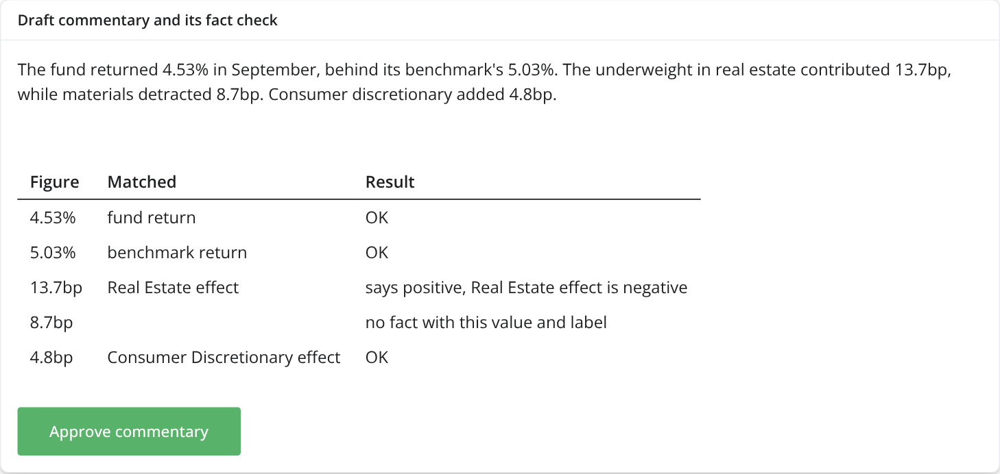
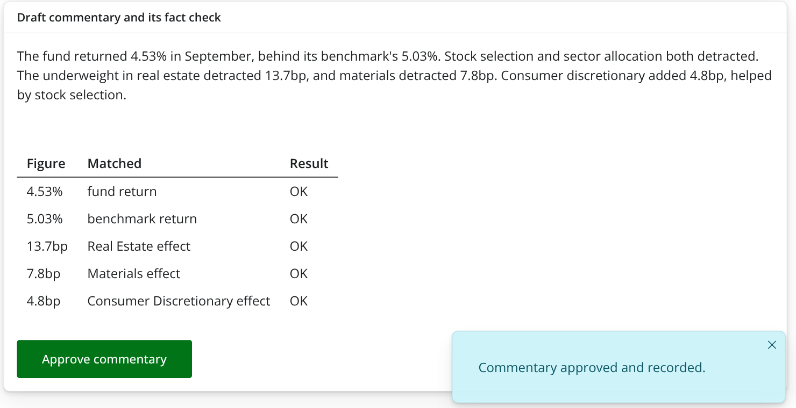

# 24. The Asset Management Application, and Your Next Steps

## Exercises

**Exercise 24.1.** Select the 3-year period. Write down the three tiles for each fund and explain why the warning matters more on this view.

**Exercise 24.2.** Replace the second draft by the first one in the Attribution tab. What does the check show, and does a draft that passes need a human review?

**Exercise 24.3.** Select HBMA on the Portfolio tab. Which characteristic would the AM agent quote incorrectly if its prompt did not explain the field names?

**Exercise 24.4.** Add an *Approve* button to the Attribution tab that is enabled only when every figure is OK. Write it, and test it with both drafts.

**Exercise 24.5.** Write the deployment checklist for putting both applications and the service on a shared server in your firm: at least six items.

## Corrections

### Exercise 24.1

**What the question asks.** Set the period to 3 years, write down the three tiles for each fund, and explain why the past-performance warning matters more on this view.

**The plan.** (1) Read the tiles for each fund. (2) Compare the relative returns with three years of charges. (3) Compare the 3-year and 1-year views of HGEF. (4) Relate the difference to the warning.

**Step by step.** Choose *3 years* in the sidebar and select each fund in turn. The tiles call `fund_performance(fund_code, 36)`, which compounds the last 36 monthly returns of the fund and of its benchmark.

**Reading the result.**

| Fund | Fund return | Benchmark | Relative |
|------|------------:|----------:|---------:|
| HGEF |      −2.74% |    −1.07% |   −1.68% |
| HECB |       9.20% |    10.49% |   −1.29% |
| HBMA |       3.99% |     4.65% |   −0.66% |

All three funds are behind their benchmarks over three years. Over one year HGEF returned 6.46%; over three years, −2.74%.

**Checking the answer.** Compare each gap with three years of ongoing charges, since fund returns are net of fees and benchmark returns are not. HECB’s gap, −1.29%, is close to $3 \times 0.40\% = 1.20\%$. HGEF’s, −1.68%, is smaller than $3 \times 0.75\% = 2.25\%$, so before fees HGEF was ahead of its benchmark over the period. HBMA’s, −0.66%, is smaller than $3 \times 0.60\% = 1.80\%$. The figures are consistent with what each fund charges.

**Mistakes to avoid.**

- Reading the relative return as the manager’s skill without the fees. Part of every gap is the charge, which the investor pays whatever the manager does.
- Adding the three 1-year returns to get the 3-year figure: returns compound.

**Trade-offs.** The two periods give opposite impressions of the same fund, which is exactly why the warning exists: a single period’s return, good or bad, does not predict the next. Client documents go further: under PRIIPs, past performance is published for up to the last ten calendar years in a fixed format. A 1-year/3-year toggle is an internal view, convenient for specialists, not a client document.

### Exercise 24.2

**What the question asks.** Show the first draft in the Attribution tab instead of the second, read the check, and decide whether a draft that passes still needs a person’s review.

**The plan.** (1) Change one line of the app. (2) Read the check table. (3) Find what the check cannot see. (4) Decide.

**Step by step.** In `apps/am_app/app.R` change

`apps/am_app/app.R` (extract)

``` r
draft <- drafts[2]
```

to `draft <- drafts[1]`. The file `evals/drafts/hgef_commentary_2026_09.txt` holds the two drafts of Chapters 6 and 13, separated by `DRAFT 1` and `DRAFT 2`; `drafts` is the list split on those markers.

**Reading the result.** The check table for Draft 1: 4.53% fund return OK, 5.03% benchmark return OK, 13.7bp Real Estate effect OK (*detracted*, and the effect is −13.7bp), 7.8bp Materials effect OK, 4.8bp Consumer Discretionary effect OK. Five figures, no problem.

**Checking the answer.** The check verifies figures, their labels and their directions. Draft 1 also makes three claims without figures, which only a person can check against the attribution file. *“Stock selection and sector allocation both detracted”*: the column totals are −26.2bp and −14.9bp, true. Real estate detracted *“mostly through the underweight”*: allocation is −11.0bp of the −13.7bp, true. Consumer Discretionary was *“helped by stock selection”*: its selection effect is +4.55bp, true. All three are supported, but by the reviewer, not by the code.

**Mistakes to avoid.**

- Approving a draft because the table shows five OKs. The table covers figures, not the sentences around them.
- Concluding that the check is useless because a person still reads the draft. It reduced the review from every figure to two sentences.

**Trade-offs.** Yes, a passing draft still needs a review, a shorter one. To shrink it further, apply Exercise 13.2: give the model the totals as figures (*“selection detracted 26.2bp”*) so that more claims become checkable, at the price of a denser commentary. The approval then focuses on tone and on the claims no figure can carry.

### Exercise 24.3

**What the question asks.** On the Portfolio tab, select HBMA, and identify the characteristic the AM agent would quote incorrectly if its prompt did not explain field names.

**The plan.** (1) Read HBMA’s characteristics. (2) Find the fields that describe part of the fund. (3) Write the wrong and the right sentence. (4) Fix the prompt and the evaluation.

**Step by step.** The Characteristics table calls `fund_characteristics("HBMA")` through `run_tool()` and prints each field.

**Reading the result.** HBMA: 45 holdings, 5.0% cash, weighted ESG score 72.4, weighted carbon intensity 116.4, bond modified duration 6.11 years, BBB share of bonds 60.49%.

**Checking the answer.** HBMA holds 55% equities, 40% bonds and 5% cash (Exercise 22.1). `bond_modified_duration_years` (6.11) is the duration of the 40%; `bbb_share_of_bonds_pct` (60.49%) is a share of the bonds, which is $0.6049 \times 40\% = 24.2\%$ of the fund. An agent writing *“HBMA has a duration of 6.11 years”* or *“60% of HBMA is rated BBB”* gives a correct figure with a wrong meaning, and the figure check passes, because the value is in the tool result.

**Mistakes to avoid.**

- Relying on the figure check for meaning: it checks values and labels, not what the label covers.
- Fixing it by renaming the fields only. A longer name helps; the model can still drop words when it writes.

**Trade-offs.** The fix is in two places: a sentence in the system prompt (*“For HBMA, duration and rating shares refer to the bond part of the fund only; say so.”*) and an evaluation case, *“What share of HBMA is rated BBB?”*, whose keywords require *bonds*. A meaning error cannot be caught by figures; it is caught by a test written by someone who knows the domain. The tool could instead return the BBB share of the fund (24.2%) as well; one more field, one less misreading.

### Exercise 24.4

**What the question asks.** Add an *Approve* button to the Attribution tab that is enabled only when every figure of the draft is OK, and test it with both drafts.

**The plan.** (1) Add a placeholder for the button in the UI. (2) Compute whether the check passed. (3) Render the button enabled or disabled. (4) Test with each draft in `testServer()`.

**Step by step.** In the UI, add `uiOutput("approve_ui")` to the card of the draft and its check. In the server:

`apps/solutions/ex24_4/app.R` (extract)

``` r
check_ok <- reactive({
  r <- check_commentary(draft, hf$facts)
  length(r) > 0 && all(vapply(r, function(x) is.na(x$problem), TRUE))
})
output$approve_ui <- renderUI({
  b <- actionButton("approve", "Approve commentary", class = "btn-success")
  if (check_ok()) b else tagAppendAttributes(b, disabled = "disabled")
})
```

- `check_commentary()` returns one entry per figure, with `problem` set to `NA` when the figure is supported.
- `vapply(..., TRUE)` turns the entries into a logical vector; `all()` is `TRUE` only if every figure is supported.
- `length(r) > 0` refuses a draft with no figures at all: in R, `all(logical(0))` is `TRUE`.
- `tagAppendAttributes(b, disabled = "disabled")` adds the HTML attribute that greys out the button.

**Reading the result.** With Draft 2 (two errors), the button is disabled; with Draft 1, it is enabled.

**Checking the answer.** In `testServer()`, read `check_ok()` and look for `disabled` in the rendered HTML:

`chapters/ch24/r/solutions/ex24_4_minimum.R` (extract)

``` r
testServer(app, cat(check_ok(), grepl("disabled", as.character(output$approve_ui$html)), "\n"))
```

Draft 2 prints `FALSE TRUE`; Draft 1 prints `TRUE FALSE`.

**Mistakes to avoid.**

- Forgetting the empty case: a commentary without a single figure would be approvable automatically.
- Checking the draft once when the app starts and never again. In production the draft changes; the check must be a reactive expression of the current draft.

**Trade-offs.** A disabled button is guidance, not control: anyone can copy the text. The control is the record: when *Approve* is clicked, write the draft, the check results, the approver and the time to a log, as Chapter 20 requires. Approval then means that a named person took responsibility for the sentences the code could not check.

**On GitHub.** The companion repository goes further: the application also records each approval with the draft, the approver and the time (`apps/solutions/ex24_4/app.R`), with every changed line in context, a test of both drafts and of the server’s refusal, and screenshots, in `solutions/ch24_corrections.md`.

#### Going further on GitHub: approving, and recording the approval

This part is in the companion repository only. It adds what the book’s trade-off asks for: when *Approve* is clicked, the application records the draft, the number of figures checked, the approver and the time. The test runs with both drafts.

**The complete application.** `apps/solutions/ex24_4/app.R`. The variable `AIE_DRAFT` chooses the draft, so that both can be shown without editing the file:

``` bash
AIE_DRAFT=2 Rscript -e 'shiny::runApp("apps/solutions/ex24_4", port = 8124)'   # two errors: disabled
AIE_DRAFT=1 Rscript -e 'shiny::runApp("apps/solutions/ex24_4", port = 8125)'   # no error: enabled
```

**Every change, in context.**

``` diff
--- apps/am_app/app.R
+++ apps/solutions/ex24_4/app.R
@@ -1,5 +1,6 @@
-# Harbourline funds — the asset management application (Chapter 24)
-# Run from the repository root:  Rscript -e 'shiny::runApp("apps/am_app", port = 8102)'
+# Exercise 24.4 - the AM application with an Approve button, enabled only when every figure is OK
+# Run from the repository root:  Rscript -e 'shiny::runApp("apps/solutions/ex24_4", port = 8124)'
+# AIE_DRAFT=1 shows the first draft (no errors); the default, 2, shows the second (two errors)
 library(shiny); library(bslib); library(DT); library(jsonlite)
-root <- normalizePath(Sys.getenv("AIE_ROOT", "../.."))
+root <- normalizePath(Sys.getenv("AIE_ROOT", "../../.."))
 setwd(root)
@@ -50,3 +51,3 @@
     card(card_header("HGEF, September 2026: Brinson attribution (basis points)"), tableOutput("attr")),
-    card(card_header("Draft commentary and its fact check"), textOutput("draft"), br(), tableOutput("check"))),
+    card(card_header("Draft commentary and its fact check"), textOutput("draft"), br(), tableOutput("check"), uiOutput("approve_ui"))),
   nav_panel("Assistant",
@@ -92,3 +93,3 @@
   drafts <- drafts[nchar(drafts) > 0]
-  draft <- drafts[2]                                   # the second draft has two errors for the checker to find
+  draft <- drafts[as.integer(Sys.getenv("AIE_DRAFT", "2"))]   # draft 2 has two errors; draft 1 has none
   output$draft <- renderText(draft)
@@ -99,2 +100,23 @@
                Result = vapply(r, function(x) if (is.na(x$problem)) "OK" else x$problem, ""))
+  })
+
+  check_ok <- reactive({
+    r <- check_commentary(draft, hf$facts)
+    length(r) > 0 && all(vapply(r, function(x) is.na(x$problem), TRUE))
+  })
+  output$approve_ui <- renderUI({
+    b <- actionButton("approve", "Approve commentary", class = "btn-success")
+    if (check_ok()) b else tagAppendAttributes(b, disabled = "disabled")
+  })
+  # Going further than the book: the record of the approval (Chapter 20)
+  observeEvent(input$approve, {
+    req(check_ok())                                    # the server refuses too, not only the button
+    r <- check_commentary(draft, hf$facts)
+    dir.create("logs", showWarnings = FALSE)
+    row <- data.frame(time = format(Sys.time(), "%Y-%m-%dT%H:%M:%S"),
+                      approver = Sys.getenv("AIE_USER", Sys.info()[["user"]]),
+                      figures_checked = length(r), draft = draft)
+    f <- "logs/commentary_approvals.csv"
+    write.table(row, f, sep = ",", row.names = FALSE, col.names = !file.exists(f), append = file.exists(f))
+    showNotification("Commentary approved and recorded.", type = "message")
   })
```

- `drafts[as.integer(Sys.getenv("AIE_DRAFT", "2"))]` keeps the default of Chapter 24 (draft 2) and lets the test load draft 1. `as.integer()` is needed because environment variables are always text.
- `uiOutput("approve_ui")` is added inside the card, after the check table: the button appears under the figures it depends on.
- `check_ok()` and `output$approve_ui` are the code of the book.
- `observeEvent(input$approve, ...)` is the record. `req(check_ok())` stops the observer when the check fails: a disabled button can be re-enabled in the browser’s developer tools, so the server must refuse too.
- `Sys.getenv("AIE_USER", Sys.info()[["user"]])` takes the approver’s name from the deployment (Posit Connect provides the signed-in user in `session$user`; use it there) and falls back on the operating-system user on your computer.
- `showNotification()` confirms the approval on screen.

**The test, in full.** It loads the application twice, once per draft, checks the button, then clicks it in both cases: only draft 1 may be recorded.

`tests/solutions/test_ex24_4.R`

``` r
# Exercise 24.4 - the Approve button, tested with both drafts
# Run from the repository root:  Rscript tests/solutions/test_ex24_4.R
library(shiny)
Sys.setenv(AIE_ROOT = getwd(), AIE_USER = "test.reviewer")
unlink("logs/commentary_approvals.csv")
for (d in c("2", "1")) {
  Sys.setenv(AIE_DRAFT = d)
  app <- suppressPackageStartupMessages(source("apps/solutions/ex24_4/app.R")$value)                   # the draft is chosen when the file is loaded
  testServer(app, {
    disabled <- grepl("disabled", as.character(output$approve_ui$html))
    cat("Draft", d, "| check_ok:", check_ok(), "| button disabled:", disabled, "\n")
    stopifnot(check_ok() == (d == "1"), disabled == (d == "2"))
    session$setInputs(approve = 1)                                       # click, even on a disabled button
  })
}
a <- read.csv("logs/commentary_approvals.csv")
print(a[, c("approver", "figures_checked")], row.names = FALSE)
stopifnot(nrow(a) == 1)                                                  # only draft 1 was recorded
Sys.unsetenv(c("AIE_DRAFT", "AIE_USER"))
cat("Exercise 24.4 test passed\n")
```

**Output**

``` text
Draft 2 | check_ok: FALSE | button disabled: TRUE 
Draft 1 | check_ok: TRUE | button disabled: FALSE 
      approver figures_checked
 test.reviewer               5
Exercise 24.4 test passed
```

- `Sys.setenv(AIE_DRAFT = d)` must come before `source()`: the draft is chosen when the file is loaded.
- The click on draft 2 (`session$setInputs(approve = 1)`) imitates a user who re-enabled the button; the file has one row afterwards, so `req(check_ok())` refused it.

**What you should see.** With draft 2, the check finds two errors and the button is greyed out:

<figure>

<figcaption aria-hidden="true">Draft 2 with two errors in the fact check and a greyed-out Approve button</figcaption>
</figure>

With draft 1, every figure is OK; a click on *Approve commentary* records the approval and confirms it:

<figure>

<figcaption aria-hidden="true">Draft 1 with every figure OK, the Approve button enabled and the notification “Commentary approved and recorded”</figcaption>
</figure>

**More mistakes to avoid.**

- Relying on the disabled button alone. Test the server’s refusal, as the test above does.
- Recording the approval without the draft’s text. A record that says *approved* without saying *what* cannot be checked a year later.

**More trade-offs.** The CSV file keeps one row per approval on one server. For an audit trail several people rely on, write to a database table with the user’s identity from the sign-in system, not from an environment variable, which the user can set. That costs a database connection in the application and a decision on who may approve, which belongs to the firm’s governance of Chapter 20, not to the code.

### Exercise 24.5

**What the question asks.** Write the checklist for deploying both applications and the service on a shared server in your firm, with at least six items.

**The plan.** Cover six areas in turn: access, data, versions, monitoring, resilience, governance; then decide what a pilot needs.

**Step by step.**

1.  **Access.** The applications behind the firm’s single sign-on; the service reachable only from the applications’ server; one API key per caller (Exercise 18.3), stored as secrets, never in the repository.
2.  **Data.** Data folders mounted read-only; client or personal data only after the DPIA of Chapter 20 is approved; the model in the firm’s environment (Ollama on an internal server) or an external API covered by the firm’s contract and data agreement.
3.  **Versions.** Each deployment tagged in Git, with the prompt hashes and the model name recorded in the model card; the evaluation re-run on the deployed configuration before go-live, with its results attached.
4.  **Monitoring.** The JSONL log collected centrally; the alerts of Chapter 19 (error rate above 2%, review rate above 10% over five working days, p95 latency above 12 seconds) sent to a named owner.
5.  **Resilience.** Health checks on `/health`; the applications’ deterministic tabs tested with the service stopped (Exercise 23.3); a restart policy for the service and the model server.
6.  **Governance.** Both use cases in the AI inventory with owners; the risk tier agreed with the second line; a review date in the calendar.

**Reading the result.** Six items, each with an owner who can say *done* or *not done*.

**Checking the answer.** Walk one failure through the list: the model server stops on a Monday morning. Resilience restarts it; monitoring raises the error-rate alert to its owner; the applications’ dashboards keep working; versions tell support which model and prompt were running. Each item has a role in a real failure.

**Mistakes to avoid.**

- Copying the development API key to the server: it is in the book and in the repository’s defaults.
- Leaving the working directory to chance: `runApp()` and plumber change it, which is why both apps and the R service set it from `AIE_ROOT` (Chapter 23).

**Trade-offs.** Each item adds work before the first user sees the application. The minimum for a pilot with five named users is access control, the log and the evaluation; the rest must be in place before the application is opened more widely, and the governance file must say which stage you are in.
